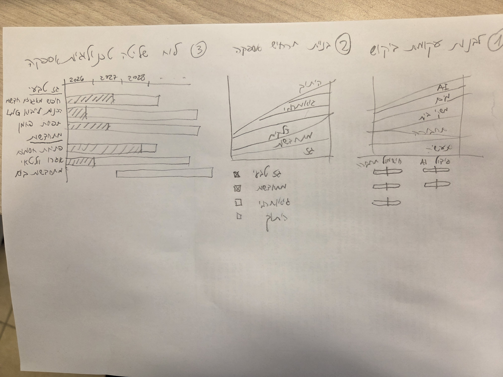

<div dir="rtl">

# דאשבורד ביקוש, היצע ומעקב: משק האנרגיה בישראל

## מסמך תכנון ואדריכלות

> **סטטוס:** שלבים 1 ו-2 מומשו. מצב הקוד העדכני מתועד ב-[CLAUDE.md](../CLAUDE.md).
> **הנחות שסוכמו:** האפליקציה סטטית ורצה בדפדפן בלבד, בלי שרת. תרחישי ביקוש ותרחישי אספקה נשמרים כקבצים מקומיים, דרך "שמור בשם" ו"פתח".



---

## 1. מטרה ועקרונות

הדאשבורד הוא כלי תכנון אינטראקטיבי שעונה על שלוש שאלות:

1. **כמה אנרגיה נצטרך?** עקומת הביקוש לפי מגזר, לאורך השנים.
2. **מאיפה היא תגיע?** עקומת אספקה שמורכבת ממקורות שונים, וצריכה לכסות את כל הביקוש.
3. **האם אנחנו בדרך?** מעקב אחרי התקדמות הפרויקטים בכל ערוץ אספקה.

**עקרונות:**

- **זרימה אחת:** ביקוש ← היצע ← מעקב. עקומת הביקוש היא קו המטרה של מסך ההיצע. יעדי ההיצע הם קו המטרה של מסך המעקב.
- **הפער תמיד גלוי:** בכל מסך רואים מה חסר, הן באנרגיה שנתית (TWh) והן בהספק שיא (GW).
- **שקיפות:** כל הנחה (קצב צמיחה, capacity factor וכדומה) גלויה וניתנת לשינוי, ונשמרת בקובץ התרחיש.
- **עברית ו-RTL**, והממשק עובד גם בטלפון.

---

## 2. מבנה המסכים

### סרגל עליון משותף

- בחירת **שנת יעד**: מסמנת אותה בכל הגרפים, וכרטיסי הסיכום מחושבים לפיה.
- בחירת יחידות: TWh לשנה או GW.
- שם התרחיש הפעיל וכפתורי **שמור בשם**, **פתח**, **שכפל** ו**איפוס לבסיס**.
- טאבים: **ביקוש | היצע | מעקב ביצוע**.

### מסך 1: עקומת ביקוש לפי מגזר

| רכיב | תיאור |
|---|---|
| גרף ראשי | גרף שטחים מוערמים לשנים 2025–2050, ב-TWh לשנה. כל שכבה היא מגזר |
| מגזרים | ביתי, מסחרי ושירותים, תעשייה, תחבורה (חשמול), AI ודאטה-סנטרים, מים והתפלה, חקלאות |
| סליידר לכל מגזר | קצב צמיחה שנתי באחוזים. הגרף מתעדכן מיד כשמזיזים אותו |
| פאנל מתקדם (נפתח) | ערך בשנת הבסיס, צורת עקומה (לינארית, מעריכית, S-curve), מקדם התייעלות, load factor |
| מדד משני | ביקוש שיא ב-GW, שמחושב מהאנרגיה השנתית ומה-load factor של כל מגזר |
| כרטיסי סיכום | סה"כ ביקוש בשנת היעד, צמיחה מצטברת, והמגזר שצומח הכי מהר |

> צורת S-curve מתאימה למגזרים שבהם צפויה קפיצה, כמו חשמול התחבורה ו-AI: צמיחה איטית בהתחלה, האצה, ואז רוויה.

### מסך 2: עקומת אספקה ממקורות

| רכיב | תיאור |
|---|---|
| גרף ראשי | שטחים מוערמים של הייצור לפי מקור, וקו מקווקו של הביקוש שמגיע ממסך 1 |
| שטח הפער | השטח בין הביקוש להיצע, כשההיצע נמוך מהביקוש, צבוע באדום |
| מקורות | גז טבעי, פחם (עם שנת הוצאה משימוש), סולארי (שדות וגגות), רוח, אגירה (סוללות ושאיבה), יבוא, אחר |
| לכל מקור | תיבת סימון שמגדירה אם הוא משתתף; סליידר הספק מותקן (GW) בנקודות עוגן לפי שנה, עם אינטרפולציה ביניהן; capacity factor; capacity credit (התרומה המובטחת לשיא) |
| "השלם אוטומטית" | מכסה את הפער לפי סדר עדיפויות שהמשתמש קובע (גוררים מקורות כדי לסדר אותם) |
| מדדים | אחוז כיסוי אנרגטי בכל שנה; כיסוי שיא ב-GW; אחוז מתחדשות מתוך הייצור |

**למה צריך שני מדדים?** מאזן אנרגיה שנתי לבדו מטעה. סולארי יכול לכסות הרבה TWh, ועדיין לא לכסות את השיא בערב. המדד של **כיסוי השיא**, שמבוסס על capacity credit, מראה מתי צריך אגירה או גיבוי.

### מסך 3: לוח מעקב ביצוע

| רכיב | תיאור |
|---|---|
| גאנט | ציר שנים (2026, 2027, 2028 ...). כל שורה היא פרויקט, והפרויקטים מקובצים לפי ערוץ אספקה |
| פס מתוכנן | המסגרת החיצונית של הפס: מתאריך ההתחלה עד תאריך הסיום המתוכננים |
| התקדמות בפועל | קטע מקווקו בתוך הפס, לפי אחוז הביצוע |
| קו "היום" | קו אנכי בתאריך "נכון ל-" |
| צבע סטטוס | ירוק = בזמן, כתום = בסיכון, אדום = מתעכב. הסטטוס נקבע לפי ההפרש בין ההתקדמות בפועל להתקדמות הצפויה בתאריך הזה |
| כרטיסי ערוצים | ה-GW הצפויים מהפרויקטים עד שנת היעד, מול היעד בתרחיש האספקה. זה החיבור בין מסך 3 למסך 2 |
| סינון | לפי ערוץ, לפי סטטוס ולפי גורם אחראי |
| חלון פרטים | אבני דרך, הספק ב-MW, גורם אחראי והערות |

---

## 3. מודל הנתונים

</div>

```ts
// ---------- ביקוש ----------
interface DemandScenario {
  id: string;
  name: string;
  baseYear: number;          // לדוגמה 2025
  horizonYear: number;       // לדוגמה 2050
  sectors: SectorDemand[];
}

interface SectorDemand {
  key: string;               // 'residential' | 'commercial' | 'industry' | 'transport' | 'ai' | 'water' | 'agri'
  label: string;             // שם להצגה בעברית
  baseTWh: number;           // הצריכה בשנת הבסיס
  growthPct: number;         // קצב צמיחה שנתי (הערך שהסליידר שולט בו)
  curve: 'linear' | 'exp' | 's';
  sMidYear?: number;         // ל-S-curve: שנת נקודת הפיתול
  efficiencyPct: number;     // הפחתה שנתית בזכות התייעלות
  loadFactor: number;        // לחישוב השיא: GW = TWh / (8.76 * LF)
}

// ---------- היצע ----------
interface SupplyScenario {
  id: string;
  name: string;
  demandScenarioRef?: string;   // שם תרחיש הביקוש שהתרחיש הזה נבנה עבורו
  sources: SupplySource[];
  fillPriority: string[];       // הסדר שבו "השלם אוטומטית" משתמש במקורות
}

interface SupplySource {
  key: string;                  // 'gas' | 'coal' | 'solar' | 'wind' | 'storage' | 'import' | 'other'
  label: string;
  enabled: boolean;             // תיבת הסימון
  renewable: boolean;           // נכלל בחישוב אחוז המתחדשות
  capacityGW: { year: number; gw: number }[];  // נקודות עוגן, עם אינטרפולציה ביניהן
  capacityFactor: number;       // 0..1
  capacityCredit: number;       // 0..1, התרומה המובטחת לשיא
  retireYear?: number;          // לדוגמה, לפחם
  maxGW?: number;               // תקרה להשלמה האוטומטית
}

// ---------- מעקב ----------
interface Project {
  id: string;
  name: string;
  channel: string;              // מפנה ל-SupplySource.key
  owner: string;
  mw: number;
  plannedStart: string;         // ISO date
  plannedEnd: string;
  progressPct: number;          // 0..100
  asOf: string;                 // תאריך העדכון האחרון
  status?: 'on-track' | 'at-risk' | 'delayed';   // אם לא מוגדר, מחושב אוטומטית
  milestones: { name: string; date: string; done: boolean }[];
  notes?: string;
}

// ---------- המעטפת של הקובץ השמור ----------
interface ScenarioFile<T> {
  schema: 'energy-dashboard/v1';
  kind: 'demand' | 'supply' | 'projects';
  savedAt: string;
  data: T;
}
```

<div dir="rtl">

- לכל קובץ יש שדה `schema` עם מספר גרסה. כך אפשר להוסיף בעתיד פונקציות שממירות קבצים ישנים לגרסה החדשה.
- כל קובץ שנטען עובר בדיקה עם **Zod** לפני שמשתמשים בו. אם הקובץ לא תקין, מוצגת הודעת שגיאה ברורה.
- **נתוני בסיס:** הקבצים בתיקייה `src/data/*.json` (נארזים עם האפליקציה ונבדקים עם Zod בטעינה) מכילים **ערכי דוגמה** ומסומנים ככאלה בממשק. מקורות מומלצים לעדכון שלהם:
  - רשות החשמל: דוחות מצב משק החשמל.
  - נגה (ניהול מערכת החשמל): נתוני ייצור וצריכה.
  - הלמ"ס: מאזן אנרגיה.
  - משרד האנרגיה: יעדי מתחדשות ותוכניות פיתוח.

---

## 4. מנוע החישוב

כל החישובים הם **פונקציות טהורות** בתיקייה `src/model/`, בלי שום תלות ב-React. כך קל לבדוק אותם, ובהמשך אפשר להחליף אותם במודל מפורט יותר.

| פונקציה | קלט ← פלט | הערות |
|---|---|---|
| `projectDemand(scenario)` | ← `{year, sector, twh, peakGW}[]` | מחשבת את העקומה לפי צורתה, ומפחיתה את ההתייעלות |
| `interpolateCapacity(points, year)` | ← `gw` | אינטרפולציה לינארית בין נקודות העוגן |
| `computeSupply(scenario, years)` | ← `{year, source, twh, firmGW}[]` | ‏`TWh = GW × CF × 8.76`, ו-`firmGW = GW × capacityCredit` |
| `computeGap(demand, supply)` | ← `{year, gapTWh, coveragePct, peakGapGW, renewablePct}[]` | הנתונים לשטח האדום ולכרטיסי הסיכום |
| `autoFill(demand, scenario)` | ← `SupplyScenario` | מילוי חמדני לפי `fillPriority`, עד שגם האנרגיה וגם השיא מכוסים |
| `projectStatus(project, today)` | ← `'on-track' \| 'at-risk' \| 'delayed'` | משווה את ההתקדמות בפועל להתקדמות הצפויה לפי הזמן שעבר |
| `projectsToCapacity(projects, channel, year)` | ← `gw` | סכום ההספק של הפרויקטים שיסתיימו עד השנה הזו (לכרטיסי הערוצים) |

**זרימת הנתונים:**

</div>

```
DemandScenario ──projectDemand──▶ demandSeries ─┐
                                                ├─computeGap──▶ gapSeries ──▶ מסך 2 (שטח אדום + KPI)
SupplyScenario ──computeSupply──▶ supplySeries ─┘
        │
        └── יעדי GW לכל ערוץ ◀── projectsToCapacity ◀── Projects ──▶ מסך 3 (גאנט + כרטיסי ערוצים)
```

<div dir="rtl">

---

## 5. שמירה וטעינה של תרחישים (בלי שרת)

| פעולה | מימוש |
|---|---|
| **שמור בשם** | ‏`showSaveFilePicker` (File System Access API) בכרום ובאדג'. בפיירפוקס ובספארי: הורדה של Blob דרך `<a download>`. הספרייה `browser-fs-access` עושה את המעבר הזה אוטומטית |
| **שמור** | אם הקובץ נפתח בכרום או באדג', שומרים לאותו קובץ (handle). אחרת, זו פעולת "שמור בשם" |
| **פתח** | ‏`showOpenFilePicker`, ואם הוא לא נתמך, `<input type="file">`. אפשר גם לגרור קובץ לחלון. הקובץ נבדק עם Zod לפני הטעינה |
| **שמירה אוטומטית** | המצב הנוכחי נשמר ב-localStorage (דרך `persist` של Zustand), כדי שלא יאבד ברענון. כל הגישות עטופות ב-try/catch, ואם השמירה נכשלת האפליקציה ממשיכה לעבוד |
| **סיומות** | ‏`*.demand.json`, `*.supply.json`, `*.projects.json` |
| **ייצוא** | CSV של סדרות התוצאות, ו-PNG של כל גרף (דרך `getDataURL` של ECharts) |

- תרחישי ביקוש ותרחישי היצע נשמרים **בקבצים נפרדים**, כדי שאפשר יהיה לשלב ביניהם: למשל, אותו תרחיש היצע מול ביקוש "נמוך" ומול ביקוש "גבוה".
- תרחיש היצע שומר את `demandScenarioRef`. אם הוא נטען כשתרחיש ביקוש אחר פעיל, מוצגת אזהרה.
- **השוואת תרחישים** (שלב 2): טוענים קובץ נוסף בתור "תרחיש להשוואה", והוא מוצג כקו מקווקו על אותו גרף.

---

## 6. טכנולוגיות

| תחום | בחירה | נימוק |
|---|---|---|
| שלד | **React 18 + TypeScript + Vite** | אפליקציה סטטית, בנייה מהירה והקלדה חזקה |
| גרפים | **Apache ECharts** (`echarts-for-react`) | שטחים מוערמים, `markArea` לשטח הפער, גאנט דרך `custom series` עם `decal` מקווקו, ייצוא PNG, ותמיכה ב-RTL |
| ממשק | **Mantine** | סליידרים, תיבות סימון, טאבים, מגירות וחלונות, עם תמיכה מובנית ב-RTL (`DirectionProvider`) ומצב כהה |
| ניהול מצב | **Zustand** עם `persist` | פשוטה וקלה. יש store נפרד לביקוש, להיצע ולפרויקטים |
| בדיקת קבצים | **Zod** | סכמה אחת שמשמשת גם לטיפוסים וגם לבדיקה בזמן ריצה |
| שמירת קבצים | **browser-fs-access** | עוטפת את File System Access API עם fallback אוטומטי |
| ניווט | **React Router** (‏HashRouter) | עובד ב-GitHub Pages בלי הגדרות בצד השרת |
| בדיקות | **Vitest** למנוע החישוב, **Playwright** לבדיקת end-to-end של "שמור ← פתח ← אותן תוצאות" | |
| איכות קוד | ESLint, Prettier, GitHub Actions (lint, test, build) | |
| אירוח | **GitHub Pages**, עם deploy אוטומטי מ-Actions בכל merge ל-main | בלי שרת ובלי עלות |

---

## 7. מבנה תיקיות

</div>

```
energy-dashboard/
├─ src/
│  ├─ data/                         # ערכי דוגמה: baseline-demand.json, baseline-supply.json (ובשלב 3 projects.json)
│  ├─ model/                        # מנוע החישוב (פונקציות טהורות)
│  │  ├─ demand.ts      demand.test.ts
│  │  ├─ supply.ts      supply.test.ts
│  │  ├─ gap.ts         gap.test.ts
│  │  ├─ autofill.ts    autofill.test.ts
│  │  └─ projects.ts    projects.test.ts
│  ├─ schema/                       # סכמות Zod והמרת גרסאות
│  ├─ store/                        # demandStore, supplyStore, projectsStore
│  ├─ io/                           # scenarioFiles.ts (שמור, פתח, שמירה אוטומטית), csvExport.ts
│  ├─ components/
│  │  ├─ charts/                    # StackedAreaChart, GanttChart
│  │  ├─ controls/                  # SectorSlider, SourceToggle, PriorityList
│  │  └─ layout/                    # TopBar, KpiCard
│  ├─ pages/                        # DemandPage, SupplyPage, TrackingPage
│  ├─ i18n/he.ts                    # כל המחרוזות
│  └─ App.tsx
├─ e2e/                             # בדיקות Playwright
└─ .github/workflows/ci.yml
```

<div dir="rtl">

---

## 8. שלבי פיתוח

| שלב | תכולה | תוצר |
|---|---|---|
| **1. MVP** | שלד ו-RTL, מסך ביקוש עם סליידרים, מסך היצע עם תיבות סימון וסליידרי GW, חישוב הפער, שמור ופתח של קבצים | כלי שאפשר לשחק בו כבר |
| **2. היצע מתקדם** | "השלם אוטומטית", כיסוי שיא ב-GW, השוואת תרחישים, ייצוא CSV ו-PNG | כלי לבחינת תרחישים |
| **3. מעקב** | גאנט, סטטוס אוטומטי, כרטיסי ערוצים מול יעדי ההיצע, עריכה ושמירה של `projects.json` | לוח שליטה מלא |
| **4. המשך** | פרופיל יומי או שעתי ("עקומת הברווז" ואגירה), ניתוח רגישות, ואם יידרש, שרת לשיתוף בין משתמשים | |

---

## 9. סיכונים ושאלות פתוחות

- **איכות נתוני הבסיס:** ערכי הדוגמה צריכים לעבור אימות מול מקורות רשמיים לפני שמשתמשים בהם לקבלת החלטות.
- **מודל שנתי:** הוא מפספס את מגבלות האגירה בתוך היממה. בשלב 1 משתמשים ב-capacity credit כקירוב, ומודל שעתי מתוכנן לשלב 4.
- **תאימות דפדפנים:** File System Access API נתמך רק בכרום ובאדג'. בפיירפוקס ובספארי יש fallback להורדה ולהעלאה של קבצים.
- **נתוני המעקב:** בלי שרת, קובץ `projects.json` מתעדכן ידנית ומופץ כקובץ. אם כמה אנשים יצטרכו לעדכן אותו במקביל, צריך לשקול שרת או שמירה במאגר git.
- **שאלה פתוחה:** מי מעדכן את נתוני ההתקדמות, ובאיזו תדירות?

</div>
